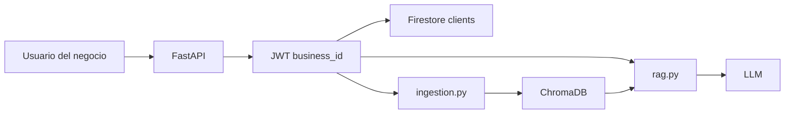

# API RAG por negocio y cliente

API REST para que cada negocio aísle a sus clientes, suba documentos de texto y pregunte sobre un cliente con RAG. El dominio no está fijo: sirve para un restaurante, una inmobiliaria, ventas u otro rubro. El prompt del modelo se configura por negocio.



## Aislamiento

`business_id` sale del JWT en cada petición. No se acepta en el cuerpo. Un negocio solo lista sus clientes, y un `client_id` de otro negocio responde 404.

Firestore guarda el negocio y sus clientes en `businesses/{business_id}/clients/{client_id}`. ChromaDB guarda los fragmentos con metadata `business_id` y `client_id`. La búsqueda siempre filtra por los dos.

El cliente tiene `name`, `contact` (teléfono o correo), `notes` opcionales y `metadata`. La edad no es un campo fijo: si un negocio la necesita, va en `metadata`.

## Endpoints

| Método | Ruta | Auth | Uso |
| --- | --- | --- | --- |
| GET | `/health` | no | Estado y proveedores activos |
| GET | `/business` | sí | Nombre y prompt del negocio |
| PUT | `/business` | sí | Configura el prompt de ese negocio |
| POST | `/clients` | sí | Crea un cliente |
| GET | `/clients` | sí | Lista solo los clientes del token |
| POST | `/documents/upload` | sí | PDF con texto o nota `.txt` / `.md`, más `client_id` |
| POST | `/chat` | sí | Pregunta sobre un `client_id` |

Los escaneos sin texto digital quedan fuera: no hay OCR. Un PDF sin texto responde 422.

## Arranque

```bash
python -m venv .venv
source .venv/bin/activate
pip install -e ".[dev]"
export JWT_SECRET="cambia-este-secreto-por-uno-largo"
export OPENAI_API_KEY="sk-..."   # o GEMINI_API_KEY / GOOGLE_API_KEY
uvicorn app.main:app --reload
```

Sin clave de modelo, los clientes se pueden crear igual. Los embeddings quedan en un hash local, que no busca por significado, y `/chat` responde 502 hasta configurar un proveedor. Indexa los documentos después de elegir el proveedor: cada modelo usa su propia colección de Chroma.

En producción define `ENVIRONMENT=production`, `JWT_SECRET`, `STORAGE_BACKEND=firestore` y `FIRESTORE_PROJECT_ID`. Sin Firestore, los clientes viven solo en la memoria del proceso. Chroma local (`CHROMA_PATH`, por defecto `data/chroma`) es de un solo proceso.

El emulador de Firestore también activa el almacén real si existe `FIRESTORE_EMULATOR_HOST`.

Variables útiles:

| Variable | Default | Uso |
| --- | --- | --- |
| `JWT_SECRET` | valor de desarrollo | Firma HS256, mínimo 32 caracteres. Obligatorio en production |
| `STORAGE_BACKEND` | `auto` | `memory` o `firestore` |
| `FIRESTORE_PROJECT_ID` | vacío | Proyecto de Firestore |
| `EMBEDDING_PROVIDER` | `auto` | `openai`, `gemini` o `local` |
| `LLM_PROVIDER` | `auto` | `openai`, `gemini`, `local` o `none`. `local` no llama a un modelo: responde un texto fijo para pruebas |
| `OPENAI_CHAT_MODEL` | `gpt-4.1-mini` | Chat de OpenAI |
| `OPENAI_EMBEDDING_MODEL` | `text-embedding-3-small` | Embeddings de OpenAI |
| `GEMINI_CHAT_MODEL` | `gemini-2.5-flash` | Chat de Gemini |
| `GEMINI_EMBEDDING_MODEL` | `gemini-embedding-2` | Embeddings de Gemini |
| `CHROMA_PATH` | `data/chroma` | Carpeta de Chroma |

Si hay clave de OpenAI y de Gemini, `auto` elige OpenAI para que chat y embeddings compartan proveedor.

## Ejemplo

```bash
export JWT_SECRET="cambia-este-secreto-por-uno-largo"
TOKEN=$(python -m app.mint_token --business-id rest01)

curl -s -X PUT http://127.0.0.1:8000/business \
  -H "Authorization: Bearer $TOKEN" \
  -H "Content-Type: application/json" \
  -d '{"name":"Casa Olivo","system_prompt":"Eres el anfitrión de un restaurante. Respondes breve."}'

curl -s -X POST http://127.0.0.1:8000/clients \
  -H "Authorization: Bearer $TOKEN" \
  -H "Content-Type: application/json" \
  -d '{"name":"Ana Ruiz","contact":"ana@example.com","metadata":{"age":34}}'

# Usa el client_id de la respuesta.
curl -s -X POST http://127.0.0.1:8000/documents/upload \
  -H "Authorization: Bearer $TOKEN" \
  -F "client_id=cli_..." \
  -F "file=@nota.txt"

curl -s -X POST http://127.0.0.1:8000/chat \
  -H "Authorization: Bearer $TOKEN" \
  -H "Content-Type: application/json" \
  -d '{"client_id":"cli_...","question":"¿Qué pidió la última vez?"}'
```

Un segundo negocio repite el flujo con otro `--business-id`. No ve los clientes ni los fragmentos del primero. Otro rubro cambia el prompt, por ejemplo: "Eres asistente de una inmobiliaria. Resume lo que los documentos dicen de este cliente."

## Pruebas

```bash
pytest
```

Las pruebas usan almacén en memoria, Chroma efímero y un chat local que no llama a un modelo. Comprueban que un negocio no lee clientes ni documentos de otro.

## Módulos

- `app/auth.py` valida el JWT y resuelve `business_id`.
- `app/services/ingestion.py` lee, limpia, parte y pide embeddings.
- `app/services/rag.py` filtra por `business_id` + `client_id`, arma el prompt del negocio y llama al modelo.
- `app/services/providers.py` esconde OpenAI y Gemini detrás de la misma interfaz.
